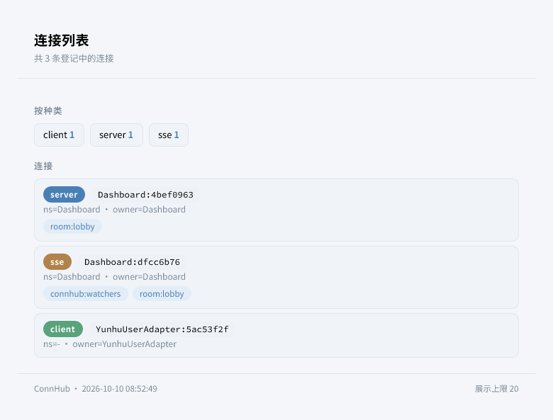
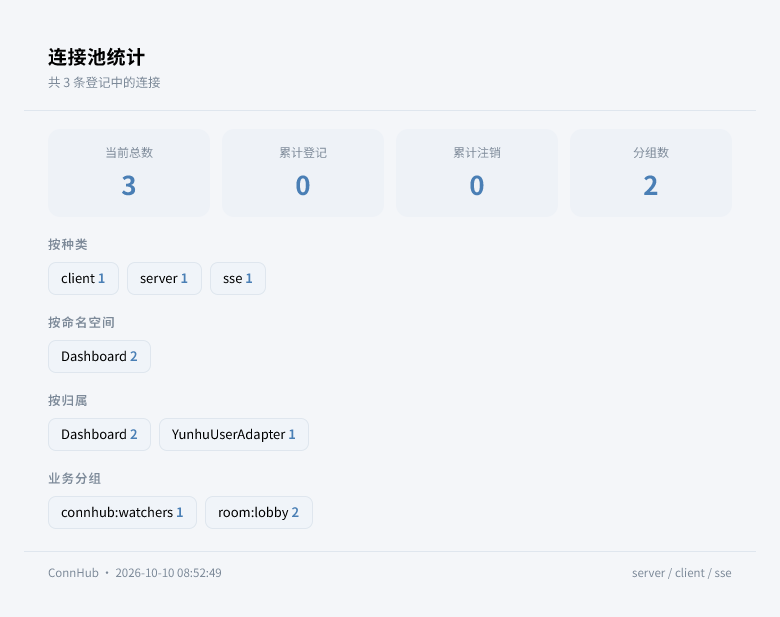
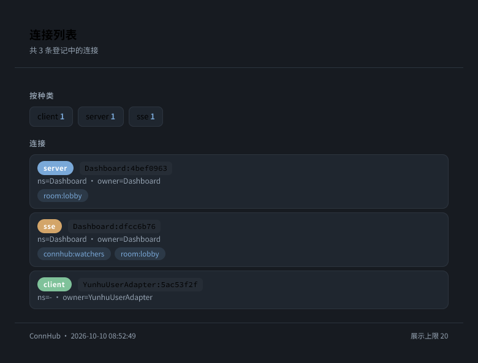
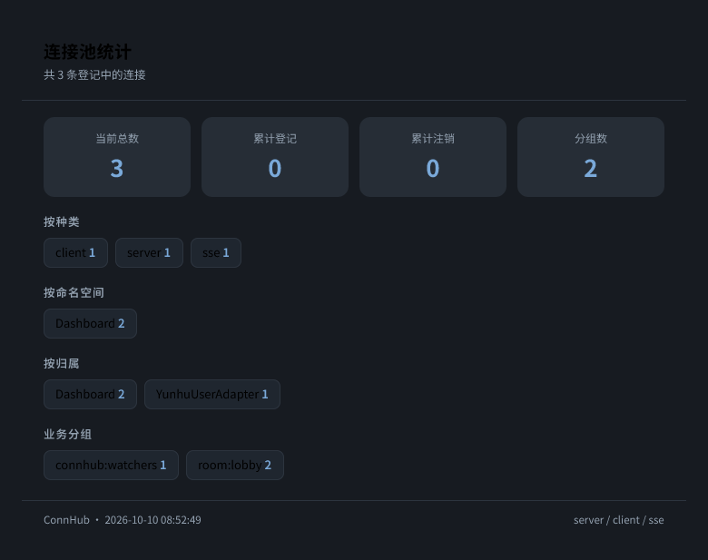

<div align="center">


# ErisPulse ConnHub

**连接中心模块 —— 管理框架登记的全部 WS/SSE 连接。**

基于 ErisPulse 2.10 连接注册表的连接管理模块，提供命令行管理、HTTP API、SSE 事件流与实时面板。

<p>
  <a href="https://pypi.org/project/ErisPulse-ConnHub/"></a>
  <a href="https://pypi.org/project/ErisPulse-ConnHub/"></a>
  <a href="./LICENSE"></a>
  <a href="https://github.com/ErisPulse/ErisPulse-ConnHub"></a>
  <a href="https://pepy.tech/project/ErisPulse-ConnHub"></a>
  <a href="https://github.com/ErisPulse/ErisPulse"></a>
</p>

<p>
  <a href="./README.md">简体中文</a> | <a href="./README.en.md">English</a>
</p>

</div>

---

## 简介

ConnHub 是基于 [ErisPulse](https://github.com/ErisPulse/ErisPulse/) 架构开发的连接管理模块。ErisPulse 2.10 起连接（服务端 WS / SSE / 出站 WS）统一登记进框架连接注册表，本模块在此基础上提供：

- 连接查询与统计（id / kind / namespace / owner / groups）
- 分组管理与定向广播
- 连接关闭（受归属权限校验约束）
- HTTP API 与 SSE 实时事件流
- 
要求 ErisPulse >= 2.10.0。

---

## 效果展示

| `/conn list` | `/conn stats` |
|:---:|:---:|
|  |  |
|  |  |

---

## 安装

```bash
epsdk install ErisPulse-ConnHub
```

---

## 命令

| 命令 | 说明 |
|------|------|
| `/conn` | 显示用法 |
| `/conn list [kind]` | 列出连接，kind 可选 `server` / `client` / `sse` |
| `/conn stats` | 连接池各维度统计 |
| `/conn group add <id> <组名>` | 连接加入分组 |
| `/conn group remove <id> <组名>` | 连接移出分组 |
| `/conn broadcast <组名\|*> <消息>` | 向分组（`*` 为全体）广播 |
| `/conn close <id>` | 关闭连接 |

全部命令需要框架主人权限。

---

## HTTP API

| 方法 | 路径 | 说明 |
|------|------|------|
| GET | `/connhub/api/connections` | 连接列表 |
| GET | `/connhub/api/stats` | 连接统计 |
| POST | `/connhub/api/broadcast` | 广播，body: `{"group": "...", "data": {...}, "timeout": 10}` |
| POST | `/connhub/api/close` | 关闭，body: `{"id": "...", "force": false}` |
| GET | `/connhub/events` | SSE 事件流（登记/注销/分组变化 + 周期快照） |

---

## 使用示例

```python
from ErisPulse import connections

# 任意模块：查看当前连接
for conn in connections.list():
    print(conn.id, conn.kind, conn.owner, conn.groups)

# 向分组广播（ConnHub 提供的命令与 API 等价于以下调用）
result = await connections.broadcast({"text": "通知"}, group="room:1")
print(result.sent, result.failed)
```

---

## 配置说明

```toml
[ConnHub]
enabled = true                  # 是否启用模块
api_enabled = true              # 启用 HTTP API 与 SSE
view_enabled = true             # 注册 Dashboard 视图
allow_force_close = false       # 允许强制关闭其他模块归属的连接
snapshot_interval_secs = 15     # 面板快照推送间隔秒数（0 关闭）
broadcast_timeout = 10.0        # 广播单连接发送超时（秒）
top_max = 20                    # 列表单次展示上限
```

| 配置项 | 类型 | 默认值 | 说明 |
|--------|------|--------|------|
| `enabled` | bool | `true` | 是否启用模块 |
| `api_enabled` | bool | `true` | 启用 HTTP API 与 SSE 事件流 |
| `view_enabled` | bool | `true` | 注册 Dashboard 连接面板视图 |
| `allow_force_close` | bool | `false` | 允许关闭其他模块归属的连接 |
| `snapshot_interval_secs` | int | `15` | 面板快照推送间隔（秒，0 关闭） |
| `broadcast_timeout` | float | `10.0` | 广播单连接发送超时（秒） |
| `top_max` | int | `20` | 列表单次展示上限 |

---

## 注意事项

1. 连接关闭权归创建者模块：关闭其他模块的连接需开启 `allow_force_close`
2. 面板以 Dashboard 视图形式提供（需安装 Dashboard 模块），SSE 事件流地址 `/connhub/events`
3. 模块卸载时其名下连接由框架自动关闭（2.10 行为）

---

## 参考链接

- [ErisPulse 主库](https://github.com/ErisPulse/ErisPulse/)
- [连接池与广播文档](https://github.com/ErisPulse/ErisPulse/tree/main/docs/zh-CN/advanced/connections.md)
